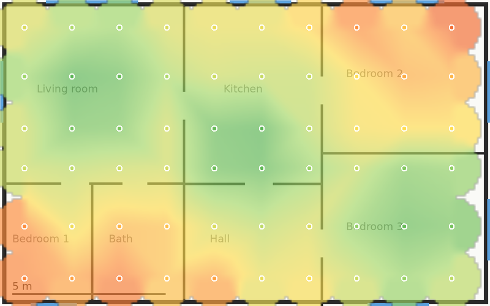
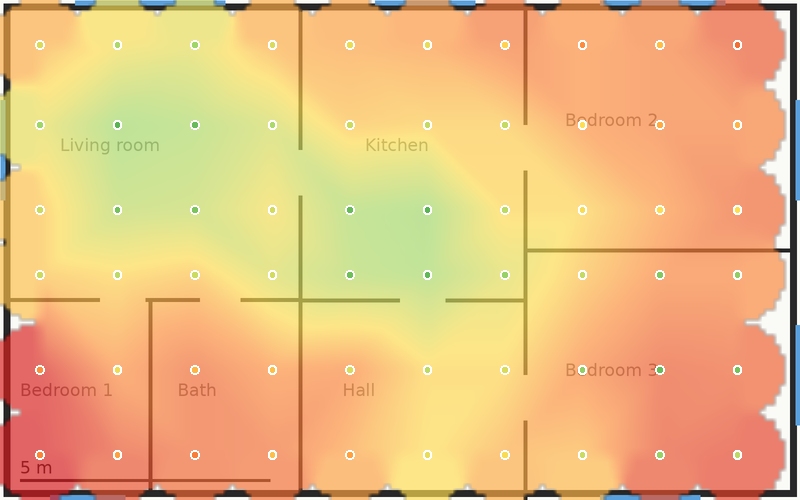
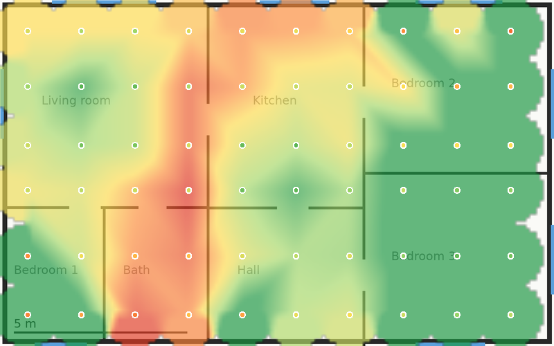
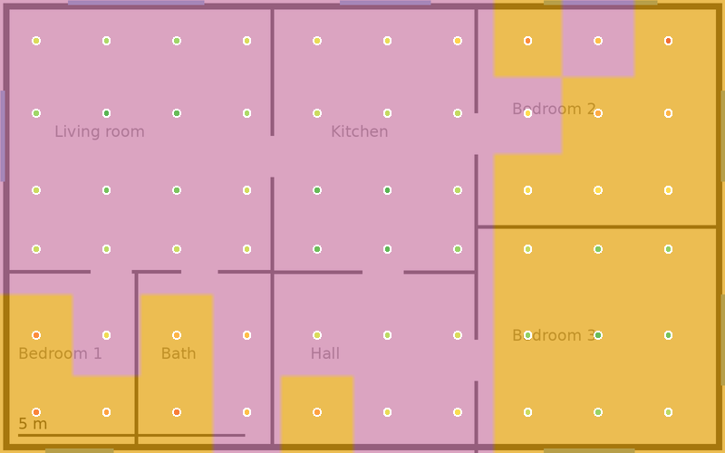
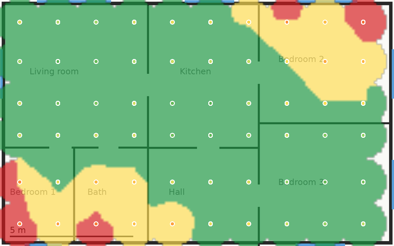

# 4. Heatmaps explained

Pictures on this page are rendered from **synthetic data** (see the [guide index](README.md)): the
sample floor plan, three invented access points (two share 2.4 GHz channel 1; the third is a
2.4 GHz-only unit in the east bedrooms) and a made-up distance-and-walls model. White dots are the
60 measurement points. The pictures come from the same renderer as **Export PNG**; the application
adds a legend and hover values on screen, which static exports do not carry.

## How a map is computed

Every map starts the same way: **one value per measurement point**, derived from the networks heard at
that point. What differs is the value (below). Then:

**Continuous maps** (signal, secondary signal, SIR, AP count, speed):

1. The plan is covered by a grid of about 160 cells along its long side.
2. Inside the area spanned by the points, values are **linearly interpolated** over a Delaunay
   triangulation of the points (each cell takes a weighted blend of the three points around it).
3. Outside that area, up to the **extension radius** from the nearest points, cells are filled by
   **inverse-distance weighting** of the points within that radius. Beyond it the cell stays empty
   (transparent). The radius is the **data point radius** you choose in the Sampling menu
   (1.5 m to 25 m by environment; 6 % of the long side if left on Automatic). With fewer than three
   points there is no triangulation and only the inverse-distance fill is used.
4. A **box blur** over only the filled cells hides seams between triangles: Off, Normal (1 cell),
   Strong (2) and Extra strong (4). Blurring never fills empty cells, so unmeasured areas stay empty.

**Categorical maps** (band coverage, PHY coverage) cannot be averaged, so each cell takes the category
of the **nearest point within twice the extension radius** and the map is never blurred.

Two consequences worth remembering:

- Linear interpolation between two points does not know about the wall between them. A map is a
  smooth guess between places you actually measured. Put points on both sides of walls.
- Colours at the edge depend on the radius. Use **Gray out unmeasured areas** (Crop tool) to see
  where the map is extrapolating.

## Signal level (best of all, or selected networks)

At each point, the **strongest** RSSI among the chosen networks, in dBm. A network that was not
heard counts as -100 dBm, the floor. "Best of all" uses every network; "selected networks"
uses the ones ticked in the right-hand list; picking a single network's target button gives that
network's own **coverage map** (places where it was not heard sit at -100 dBm).

Colours (default): red at -90 dBm, orange at -75, yellow at -67, light green at -55, green at -35.

*Signal level, synthetic data. Strongest near each access point and falling off through walls.*

## Secondary signal level

The **second-strongest** RSSI at each point among the chosen networks (all of them if none are
ticked); a point that hears fewer than two gets -100 dBm. It answers "if the AP I am connected to
disappears or I move, is there another to roam to?". Red areas have no usable second choice.

*Secondary signal, synthetic data. The reds in the corners have no useful second network.*

## Signal-to-interference (co-channel)

At each point the **serving** network is the strongest of the chosen ones (all if none are
ticked). Every *other* network heard at that point whose spectrum overlaps the serving network's
channel adds interference:

- Overlap is computed from channel centre and width (read from the beacon), within the same band
  only. A network on another band or a non-overlapping channel adds nothing.
- Each interferer's power is assumed to spread evenly over its own width, so it contributes in
  proportion to how much of the serving channel it covers.
- Powers are summed in milliwatts, then **SIR = serving RSSI - 10 log10(sum)** in dB.

If nothing interferes, SIR is capped at 40 dB; if the serving network was not heard at all it is 0 dB.
Colours (default): red at 0 dB, orange at 10, yellow at 15, light green at 25, green at 35.

What it does **not** include: thermal noise or non-Wi-Fi interference (so it is *not* SNR or SINR; see
[why](09-troubleshooting.md#why-are-there-no-snr-or-noise-maps)), how busy each network is (a loud but
idle neighbour counts fully), and anything outside the serving network's band. Other networks you
selected also count as interference to each other, which is intentional: two of your own APs on one
channel do interfere.

*SIR, synthetic data. Lowest where the two co-channel access points (1 and 2) are heard at similar
strength; the east bedrooms are green because only the third AP, on channel 11, is heard there.*

## Frequency band coverage

Which bands are **audible**, meaning at or above -80 dBm, among the chosen networks, as one of:
No signal (grey), 2.4 GHz only (orange), 5 GHz only (blue), 6 GHz only (green), Several bands
(purple). The -80 dBm limit is fixed in the application. This is the map for "does this room have
5 GHz at all".

*Band coverage, synthetic data. Purple: several bands. Orange: only 2.4 GHz is audible, mostly in
the east where no 5 GHz radio reaches.*

## PHY mode coverage

The **newest generation** advertised by the strongest chosen network at each point: 802.11 a/b/g,
n (Wi-Fi 4), ac (Wi-Fi 5), ax (Wi-Fi 6/6E), be (Wi-Fi 7), or no signal. The generation is what the
AP *advertises* in its beacon, not what a client achieved.

## Number of access points

How many networks are heard at or above -80 dBm at each point. Many APs on one band is not
automatically bad (a good mesh hears many), but a spot hearing a lot of strong, unrelated networks is
likely to be congested.

## Active scan maps

Measured throughput and jitter: HTTP download and upload, iperf3 TCP down and up, iperf3 UDP down and
up, and UDP jitter. Available after an [active scan](05-active-scan.md). A point without a result
for the chosen test contributes **nothing** (not zero), so an unmeasured spot is unknown, not slow;
the map interpolates between the points that were measured. Throughput colours run from red at 0 Mbit/s
to green at 300 Mbit/s and above; jitter is the one map where low is good (green at 0 ms, red at 60 ms).

## Troubleshooting view

Tick **Troubleshooting** to turn a continuous map (signal, secondary signal or SIR) into three
regions:

| Region | Rule |
|---|---|
| Good (green) | value at or above the "good" threshold |
| Acceptable (yellow) | between the two thresholds |
| Critical (red) | value at or below the "critical" threshold |

Defaults when you switch it on, editable in the toolbar:

| Map | Good at or above | Critical at or below | Why these values |
|---|---|---|---|
| Signal level | -67 dBm | -75 dBm | -67 dBm is a widely quoted design target for voice and video grade coverage; weaker than about -75 dBm is where connections become unreliable |
| Secondary signal | -75 dBm | -85 dBm | A looser bar than the primary: a fallback network only has to keep a roaming client connected |
| SIR | 15 dB | 10 dB | Below roughly 10 dB co-channel interference starts to cost throughput |

**Where these numbers come from, honestly.** They are rules of thumb from common wireless design
guidance, set in `Metric::default_thresholds` in the heatmap crate. They are **not** taken from
the IEEE 802.11 standard, which defines no coverage thresholds, and this repository has not tied each
to a specific document or validated them against measurements (roadmap item Q-01, a validation corpus,
is not done). Treat them as starting points and set values that match your devices and applications:
an IoT sensor needs less than a video call, and a warehouse scanner may need more.

*Troubleshooting view of the signal map with the default thresholds, synthetic data.*

## What the Inspector uses, for comparison

The Inspector's percentage is a straight line from -100 dBm (0 %) to -50 dBm (100 %), the
convention Windows documents for its own signal quality, so it matches what the OS shows. The
channel advisor's "clear / moderate / busy" labels use -82 dBm and -72 dBm; see
[Inspector](02-inspector.md#channel-advisor).

## Maps that are not available

| Map | Status |
|---|---|
| SNR and noise level | **Not available.** Windows exposes no noise value to applications. See [NOISE_FLOOR.md](../NOISE_FLOOR.md). |
| Wireless transmit rate | **Not available.** The rate is not recorded per measurement point. |
| Predicted maps for planned networks | The prediction engine exists; the Planning interface is [coming in this build](10-planning.md). |
